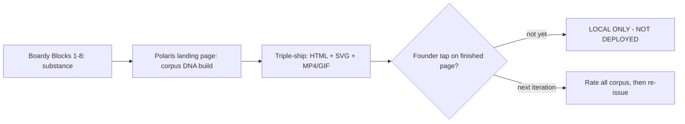

<!--
  SOM-DOC-10858-v1.0.0
  Ghost Catalog: SOM-DOC-10858
  Title: POLARIS APPLICANT DOSSIER
  Page file_id: SOM-POL-0001-v0.1.0 · Category: APPLICANT-DOSSIER · Agent: boardy (substance) / witness (build)
  Status: DRAFT · LOCAL ONLY · NOT DEPLOYED
-->

# POLARIS — Applicant Dossier

Sam Stave · Research Engineer, Polaris · Google DeepMind, Mountain View
Job: https://www.google.com/about/careers/applications/jobs/results/114077679900074694-research-engineer-polaris-deepmind

**Premise:** One week per task. Six checks per task. Every claim graded.
The application is not a resume. It is one finished task, its grader, and
agent attestations in the same evidence format — failure modes included.

**Reading path:** 01 Claim → 02 Failure modes to checks → 03 Task + grader →
04 Evidence (4 charts) → 05 Agent attestations → OWED list.

**State, honestly:**
- Substance: Boardy Blocks 1–8, 2026-11-18 (this repo drops them into corpus DNA; markup is ours and will be replaced by the estate build system).
- Witness attestation: FILLED, from the 2026-11-18 side chat in this dossier's record.
- Other agent attestations: OWED — empty slots on the page say OWED, not "coming soon".
- Numbers in Block 6: as supplied in Blocks 1–8. Corpus-wide re-rating is the NEXT iteration (founder, 2026-11-18) — no number here was re-derived in this build, and the page says so in its footer.
- Hosting: NONE. The publish-to-polaris.somacosf.com line was explicitly withdrawn by the founder ("ignore the hosting line", 2026-11-18 21:24 PT). Local git repo only. No GitHub push, no deploy.

## Files
- `site/index.html` — the landing page (interactive triple-ship member 1)
- `assets/polaris-evidence.svg` — evidence infographic, 1200×1560 (member 2)
- `motion/polaris.mp4` / `motion/polaris.gif` — program motion, PIL+ffmpeg (member 3)
- `motion/BEATS.md` — beat sheet + facts source
- `ATTESTATION-WITNESS.md` — Witness table as delivered in chat, 2026-11-18
