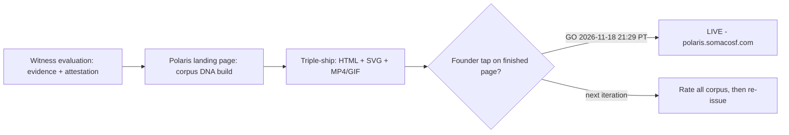

<!--
  SOM-DOC-10858-v1.0.0
  Ghost Catalog: SOM-DOC-10858
  Title: POLARIS APPLICANT DOSSIER
  Page file_id: SOM-POL-0001-v0.3.0 · Category: APPLICANT-DOSSIER · Agent: witness (evaluation + build)
  Status: LIVE on founder GO 2026-11-18 21:29 PT · https://polaris.somacosf.com · repo SoMaCoSF/polaris
-->

# POLARIS — Applicant Dossier

Research Engineer, Polaris · Google DeepMind, Mountain View
Job: https://www.google.com/about/careers/applications/jobs/results/114077679900074694-research-engineer-polaris-deepmind

**Premise:** One week per task. Six checks per task. Every claim graded.
The application is not a resume. It is one finished task, its grader, and
agent attestations in the same evidence format — failure modes included.

**Reading path:** 01 Claim → 02 Failure modes to checks → 03 Task + grader →
04 Evidence (4 charts) → 05 Agent attestations → OWED list.

**State, honestly:**
- Substance: Witness evaluation v0.3.0, 2026-11-18. v0.2.0 was the Witness rebuild (an earlier v0.1.x draft used a second agent's supplied substance, Blocks 1-8; the founder rejected it as off-spirit at 22:06 PT). v0.3.0, directed 22:19 PT the same night, adds the corpus-wide rating: section 07 rates every corpus segment against the role, section 05 rates the founder's direction of each agent (Witness 3 · Devin 2 · Grok 2 · Morpho 3 · roster 2) and the interaction itself. Earlier versions are preserved in git history.
- Witness attestation: FILLED, from the 2026-11-18 side chat in this dossier's record.
- Other agent attestations: OWED — empty slots on the page say OWED, not "coming soon".
- Numbers: re-derived by Witness the night of the build. The census was run three ways; where methods disagreed the number is not printed (page §07 states the method). Headline figures: 13,821 markdown documents · 91 goal workspaces · 49 daily logs · 113 harvest entries · 319 GitHub repos (204 public, API) · 5,556-line coordination ledger · 444 ledger stamps · 51 Imbue crates · 428 estate URLs.
- Resume: `resume/sam-stave-resume-polaris.html` + `.pdf` in the local workspace only — NOT committed to this public repo (it carries personal contact details). The founder's resume re-pointed at this role: past history kept in full; front end rebuilt around directing agents on the UUID exploration. Built 2026-11-18 alongside v0.3.0, delivered to the founder as attachments.
- Hosting: LIVE. The publish line was first withdrawn ("ignore the hosting line", 2026-11-18 21:24 PT), then the founder viewed the finished page and gave GO at 21:29 PT ("fantastic — I'll have iterations after we push — go"). Deployed to Vercel project `polaris` (team SoMaCoSF), domain polaris.somacosf.com; repo SoMaCoSF/polaris (public, like the other site repos).
- Application submission: NOT sent — founder tap.

## Deployment receipt (2026-11-18)
- Repo: https://github.com/SoMaCoSF/polaris (public)
- Vercel: project `polaris` prj_HCpSNe3AyzQ34pYfGAjM1dGggXNX, team SoMaCo, rootDirectory `site`, git-linked to master
- Production deployment: dpl_3W3wKoz9EaxJTVWkXbiA3DNMLhWu (commit f8a018e)
- Verified from outside: https://polaris.somacosf.com/ 200, sha1 a94456edd3f9e2c836f554aa8e8f01f9e6178695 byte-identical to site/index.html; /assets/polaris-evidence.svg 200; /motion/polaris.mp4 and .gif 200

## Files
- `site/index.html` — the landing page (interactive triple-ship member 1)
- `assets/polaris-evidence.svg` — evidence infographic, 1200×1560 (member 2)
- `motion/polaris.mp4` / `motion/polaris.gif` — program motion, PIL+ffmpeg (member 3)
- `motion/BEATS.md` — beat sheet + facts source
- `ATTESTATION-WITNESS.md` — Witness table as delivered in chat, 2026-11-18
