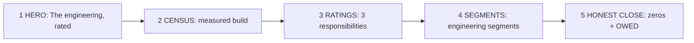

<!--
  SOM-DOC-10858-v0.4.0
  Ghost Catalog: SOM-DOC-10858 (motion companion)
-->
# POLARIS — beat sheet v0.4.0

Subject: Polaris dossier — the engineering, rated. Viewer: hiring reviewer / Sam, pre-submission review. End-state: viewer can state the engineering census (registry, splats, proven capacity, proof reruns), the three responsibility ratings, the segment ratings, and the honest zeros — rated, not inflated. Length: 20.0s, 1280×720, 12fps, 240 frames, 5 beats × 4.0s.
Facts source: PROOFS.md (SOM-DOC-10542), Atlas BEATS (SOM-DOC-10741), SCPM BEATS, deployed-urls data.json (428 rows), estate daily-state (85 records), Imbue crate/LOC count (51 / 302,450) — all read 2026-11-18. The founder's private workstream does not appear in this film. Cards never upgrade a claim. Brand: paper #08090A, ink #E8E6E1, muted #9A978E, gold #C9A227 focal only. Type: DejaVu Sans Mono. All text inside y ∈ [60, 660].

## Beats

1. **HERO (0.0–4.0s) — carrying beat.** Claim: the applicant's corpus build — substrate, atlas, estate — measured, not described. On-card: "The engineering, rated." Gold on the word "rated." only (focal claim).
2. **CENSUS (4.0–8.0s).** Claim: the build is counted from its artifacts. On-card, five rows, numbers first: 20,211 Atlas registry elements · 16,701 SCPM map splats · 447,453 MW EIA capacity PROVEN · 201,152 proof mints, 0 collisions · 51 crates, 302,450 lines of Rust. Caption: "Measured from source artifacts, 2026-11-18."
3. **RATINGS (8.0–12.0s).** Claim: fit against the posting's three responsibilities, Witness scale 1–3. On-card: Designing eval tasks 2/3 · Evaluating model weaknesses 3/3 · Building data and pipelines 2/3, as filled-block bars (3/3 bar gold — the one full mark). Caption: "Witness scale 1–3 · the posting's three responsibilities."
4. **SEGMENTS (12.0–16.0s).** Claim: the engineering segments, same scale. On-card: GYST proofs 3 — claims re-run, parity 1,200/1,200 · Atlas + i3 3 — every view a function of the registry · SCPM 2 — snapshot, regeneration builder owed · Estate + Says 2 — presentations over the registry. 3/3 names gold, 2/3 names ink.
5. **HONEST CLOSE (16.0–20.0s).** Claim: the zeros stay on the card. On-card: 0 production mints · 0 adopters · solo Polaris-shaped task OWED · GeoHex anchor CANDIDATE_NOT_RATIFIED, SCPM builder missing · "rated, not inflated." OWED and the closing line gold (focal honesty). Footer: SOM-POL-0001 · SOM-DOC-10858 · polaris.somacosf.com.
