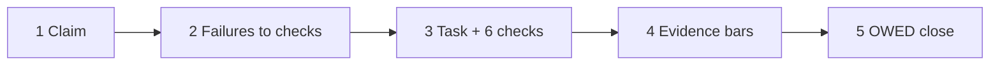

<!--
  SOM-DOC-10858-v1.0.0
  Ghost Catalog: SOM-DOC-10858 (motion companion)
-->
# POLARIS — beat sheet
Subject: Polaris applicant dossier. Viewer: Sam, pre-submission review. End-state: viewer can state the claim, the 4 failure->check mappings, and the OWED list. Length: 20.0s, 1280x720, 12fps.
Facts source: Boardy Blocks 1-8 (2026-11-18) + Witness attestation (chat, 2026-11-18). No claim upgrades a supplied number to re-derived.

Beats: 1 HERO claim · 2 FAILURE MODES -> CHECKS (4 rows) · 3 SEADC TASK, 6 binary checks, <5/6 fail · 4 EVIDENCE 466 / 73 collisions published · 5 OWED named, not hidden.
