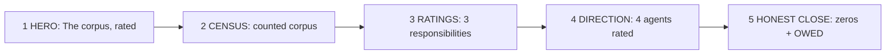

<!--
  SOM-DOC-10858-v0.3.0
  Ghost Catalog: SOM-DOC-10858 (motion companion)
-->
# POLARIS — beat sheet v0.3.0

Subject: Polaris dossier — the corpus, rated. Viewer: hiring reviewer / Sam, pre-submission review. End-state: viewer can state the corpus census, the three responsibility ratings, how the applicant directs each agent, and the honest zeros — rated, not inflated. Length: 20.0s, 1280×720, 12fps, 240 frames, 5 beats × 4.0s.
Facts source: LOCKED facts measured by parent 2026-11-18 (census + Witness ratings + direction ratings + honest close). Cards never upgrade a claim. Brand: paper #08090A, ink #E8E6E1, muted #9A978E, gold #C9A227 focal only. Type: DejaVu Sans Mono. All text inside y ∈ [60, 660].

## Beats

1. **HERO (0.0–4.0s) — carrying beat.** Claim: the applicant's year of agent work, measured — not described. On-card: "The corpus, rated." + subline verbatim. Gold on the word "rated." only (focal claim).
2. **CENSUS (4.0–8.0s).** Claim: the corpus is counted, not characterised. On-card, five rows, numbers first: 13,821 markdown documents · 91 goal workspaces · 49 daily memory logs · 319 GitHub repos · 5,556-line coordination ledger. Caption: "Counted 2026-11-18. Not described — counted."
3. **RATINGS (8.0–12.0s).** Claim: fit against the posting's three responsibilities, Witness scale 1–3. On-card: Designing eval tasks 2/3 · Evaluating model weaknesses 3/3 · Building data and pipelines 2/3, as filled-block bars (3/3 bar gold — the one full mark). Caption: "Witness scale 1–3 · the posting's three responsibilities."
4. **DIRECTION (12.0–16.0s).** Claim: how he directs each agent, rated on the same scale. On-card: Witness 3 · Devin 2 — fired on economics, output was preparation not builds · Grok 2 — strong exploration, deliverables re-verified twice · Morpho 3 — he designed the interface; its audit caught his own desk's phantom numbers. 3/3 names gold, 2/3 names ink.
5. **HONEST CLOSE (16.0–20.0s).** Claim: the zeros stay on the card. On-card: 0 production mints · 0 adopters · solo Polaris-shaped task OWED · "rated, not inflated." OWED and the closing line gold (focal honesty). Footer: SOM-POL-0001 · SOM-DOC-10858 · polaris.somacosf.com.
